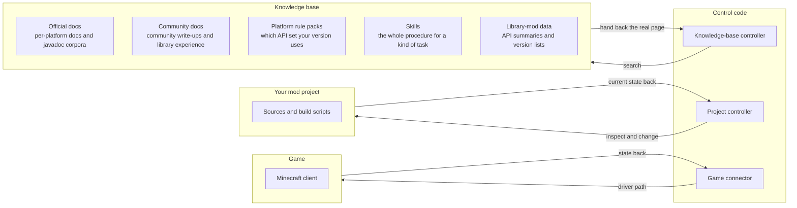

<div align="center">

<a href="https://github.com/guguzea/MC-AI-Coding-Assistant-Tool"></a>&nbsp;&nbsp;<a href="https://github.com/guguzea/MC-AI-Coding-Assistant-Tool"></a>&nbsp;&nbsp;<a href="https://github.com/guguzea/MC-AI-Coding-Assistant-Tool"></a>&nbsp;&nbsp;<a href="https://github.com/guguzea/MC-AI-Coding-Assistant-Tool"></a>&nbsp;&nbsp;<a href="https://github.com/guguzea/MC-AI-Coding-Assistant-Tool"></a><br />
[](https://github.com/guguzea/MC-AI-Coding-Assistant-Tool)&nbsp;&nbsp;[](README.en.md)&nbsp;&nbsp;[](AUTO_SETUP.md)<br />
[](LICENSE)&nbsp;&nbsp;[](THIRD_PARTY_NOTICES.md)<br />
[](https://github.com/guguzea/MC-AI-Coding-Assistant-Tool/stargazers)&nbsp;&nbsp;[](https://github.com/guguzea/MC-AI-Coding-Assistant-Tool/forks)&nbsp;&nbsp;[](https://github.com/guguzea/MC-AI-Coding-Assistant-Tool/issues)&nbsp;&nbsp;[](https://github.com/guguzea/MC-AI-Coding-Assistant-Tool/commits)<br />
<a href="https://discord.gg/vY8n6G865"></a>&nbsp;&nbsp;<a href="https://github.com/user-attachments/assets/41e370aa-611c-4af2-ad9a-007e1973a24a"></a>

</div>

<div align="center">

<br />
<br />


</div>

---

<div align="center">

[简体中文](README_human.md) | **English**

[Technical docs & agent contract](README.en.md) · [Install & configure](AUTO_SETUP.md) · [Agent master guide](AGENTS.md) · [Changelog](mcp-server/CHANGELOG.md)

# For humans: what this toolset does for you

**What it can do, and how to start using it.**

</div>

The finer details — version lists, tool parameters, boundary conditions, measured results — all live in [README.en.md](README.en.md), which is the single source for technical facts and the contract the agent follows.

## Why this is split into two documents

The README is genuinely long and dense, so this page keeps only what a human needs. If you want the fine detail, asking your own AI assistant beats reading it yourself.

- When you install this project, the agent reads [README.en.md](README.en.md) in full first. To work around the failure mode where an agent reads a long document and then quietly does nothing, that file is deliberately written as a thorough manual — which is exactly what makes it tiring for a human.
- To keep things readable, the human-facing part was split out into this page.
- On top of that, GitHub's README rendering is odd: stuffing everything onto the front page makes the entry points harder to find, not easier.

## In one sentence

AI coding assistants (Cursor, Claude Code, and others) stop guessing when they write Minecraft mods: they know which API set, build setup, and mapping layer your version uses — and they know which parts they have not verified.

## How it actually works for you



In plain words (in case the diagram does not render):

- The **knowledge base** holds five kinds of material: official docs (per-platform online docs and javadoc corpora for Forge / Fabric / NeoForge …), community docs (community write-ups, anti-patterns, library experience), platform rule packs (the constraints for which API set your version uses — this is what a session injects), Skills (the whole procedure for a kind of task), and library-mod data (API summaries and version lists for library mods). It only ever gets **read**; it never acts on its own.
- The **knowledge-base controller** is the hand AI uses to search it: the agent asks for something, the controller searches, reads out the real page, and hands it back. **The AI does not remember answers** — every answer comes from here, which is exactly why it cannot invent them.
- The **project controller** is the only hand that touches your files: it inspects and changes your mod project (reads `build.gradle`, validates registries, generates models / lang files / datapacks). By default it only **shows you**; actually writing to disk needs your go-ahead each time — which is why that arrow goes both ways: once a change lands, your project's **current state comes back** so the next round can judge it.
- The **game connector** is the third hand, the one that talks to the game. When a change has to be verified on a real client, it lets the AI drive the game through the driver path (walk somewhere, scan blocks, screenshot, collect evidence), and the state comes back so the agent can decide whether the change actually worked.

> For what exactly sits in each layer, see "Project layout" and "MCP/CLI TOOLS" in [README.en.md](README.en.md). "Control code" is the repo's `mcp-server/`; "your mod project" is your own mod's directory.

## Who it is for

- People who want to write mods without fighting the setup
- Mod developers who want fewer wrong answers from AI
- People letting AI edit code but worried it will invent method names
- Pack and server maintainers (dependency checks, crash triage)
- Server developers writing **Paper / Spigot plugins** (a separate server face, its own section below)
- Developers who want to see how other people's mods are written (decompile + source search)
- Anyone starting on an old version (the Forge rule tree goes back to `1.7.10`; LiteLoader / Rift / ModLoader each keep their own thin line)

## Three steps to start

1. **Install it**: build it and wire it into your AI host following [AUTO_SETUP.md](AUTO_SETUP.md) (Cursor / Claude Code / VS Code / Continue / Trae / OpenCode / Codex / DSH, and others). Node.js 22.5 or newer is required.
2. **Let it see your mod project**: open the project in your host. The agent identifies the platform and the exact version per [AGENTS.md](AGENTS.md), then loads the matching rule set into the conversation.
3. **Ask for what you need**: look up docs, generate code, triage a crash, or let it playtest inside the game. Anything that writes files, runs Gradle, copies jars, or uploads a release is shown to you first and waits for your confirmation.

> **Before you start building, spend one round aligning the requirements**: hold off on new content / mechanics / gameplay until the AI has run the repo's requirement-grilling skill `mc-grill`. It asks one round of questions at a time, each with a recommended answer, until every branch of the design tree is decided, then hands you a consensus list and waits for your confirmation before writing anything. To trigger it: say "grill me / help me pin down the requirements / let's align first", or type `/mc-grill` (the reliable way); when the requirements are still open, it also enters this step on its own.

## What it can do

### Platform rules and skills

Every platform and version ships its own rule set (registration, events, networking, data generation, anti-patterns, …) plus a batch of task-specific skill files. The agent loads **your** version's set, not a neighbouring one.

57 packs load today (Forge 15 / Fabric 15 / NeoForge 12 / Quilt 10 / LiteLoader 1 / Rift 2 / ModLoader 1 / Bedrock 1; `activate_platform_pack --action=list` shows the current list); 5 more on disk are `draft` (Forge 1.21.1, LiteLoader 1.8.9 / 1.10.2, ModLoader 1.2.5 / 1.5.2). When your version has no pack it says `PACK_NOT_FOUND` and offers the sibling versions instead of quietly substituting one.

Version history is answerable too: `get_version_info` takes a Forge version plus an action (say "register a block") and returns the recommended approach, key changes and gotchas.

> Details in the "Agent Skills" and "Rule files" sections of [README.en.md](README.en.md)

### Official documentation search (works offline)

Forge / Fabric / NeoForge / Quilt / LiteLoader / Rift / Bedrock docs are fetched into a local corpus and searched with a mix of keyword and semantic ranking. Results come back as real page ids you can expand into a summary or the full text. No network needed. Which versions have data is recorded in the data packs.

The server line shares this search under different platform ids: `paper` / `paper-api` / `spigot` — the difference is in "Server face" below.

> Details in "Notes on using the MCP tools" in [README.en.md](README.en.md)

### Bedrock Add-Ons

Bedrock shares nothing with Java: the corpus is Microsoft Learn's Bedrock docs plus the JSON inside packs, with its own group of 9 tools — doc search, summary / full text, `manifest.json` and behaviour-pack entity JSON validation, manifest and BP entity generation, and `content_log.txt` triage. Yarn / Mixin / `query_api` map onto nothing here.

> Details in section 6b of the tool reference in [README.en.md](README.en.md)

### API, signatures, and mappings

Look up method signatures and parameter names for Vanilla APIs by class and method (the index stops at 1.16.5–1.20.4; older versions carry SRG names and 26.1+ has no obfuscation layer — past those edges you get an error code, not a plausible false signature); look up loader and library APIs; convert class, method, and field names between mojang / MCP / Yarn / Parchment / obfuscated naming; and reverse a single obfuscated token from a crash log (`method_6032`, `er`, `func_110143_aJ`, …) back to a readable name. When a mapping layer is missing, it says so instead of passing an empty shell off as an answer.

> Details in "Mapping conversion" and "Tool boundaries" in [README.en.md](README.en.md)

### Access transformers, mixins, and resources

Bytecode-level validation of Access Transformer / Access Widener configs (Forge / NeoForge / Fabric), mixin injection-target analysis, data pack JSON validation, static audits of model and texture references, and resource pack format checks. It validates the project itself too: whether `mods.toml` / `fabric.mod.json` / `neoforge.mods.toml` line up with the entrypoints. To check whether a Vanilla registry id (`minecraft:xxx`) exists, use `query_registry`. There is also a workflow template library (new block / item / entity / GUI / worldgen / config / GameTest, …) where each template states the order of operations.

> Details in sections 9 and 10 of the tool reference in [README.en.md](README.en.md)

### Library mods: choosing and wiring them

Community-written notes on libraries such as Cloth Config, YACL, GeckoLib, JEI, Curios, and Kotlin for Forge, each saying when to use it, how to declare it, and which version traps exist. `check_dependencies` reads your `build.gradle` and metadata files and reports which libraries are declared and whether the version windows line up.

> Details in "Community knowledge and library mods" in [README.en.md](README.en.md)

### Code and resource generation

Skeletons for new blocks, items, entity renderers, worldgen, network packets, configs, language files, models, and blockstates. **Text output by default** — writing to disk needs your explicit confirmation. For third-party libraries (YACL and friends) you supply the jar, otherwise you get a structure shell explicitly marked unverified.

> Details in section 10 of the tool reference in [README.en.md](README.en.md)

### Decompiling and reading mod sources

When the docs do not cover it, read the source: `analyze_mod_jar` reads a jar's metadata, `decompile_mod_jar` decompiles into the local cache, `get_minecraft_source` pulls a class of MC source (1.14–1.21.11 through Yarn, 26.x already deobfuscated), `search_mod_code` greps the output, `download_official_mdk` fetches the official MDK. Zero downloads by default; artifacts land only in `MC_SKILL_CACHE`, never in your project; JDK 17+ required. Bring your own jar and `ingest` it for libraries or loaders we cannot download (LiteLoader / Rift / ModLoader).

> Details in "Decompiling mod sources" §13 / §14 of [README.en.md](README.en.md)

### Dependencies, upstream versions, and the pre-release check

`check_dependencies` reads your build script and metadata and reports declared libraries and version windows. `query_upstream_releases` asks upstream directly (forge / neoforge maven, yarn, parchment, Modrinth, Mojang manifest) whether a version exists at all — "could not reach it" and "it really is not there" are two different signals, and neither equals "this repo has no docs for it". `check_publish_ready` runs the pre-release checks (license / version / `build/libs`). None of the three uploads anything.

> Details in sections 8 and 11 of the tool reference in [README.en.md](README.en.md)

### Diagnostics and crash triage

Parses crash reports, game logs, and Gradle build failures; infers missing prerequisites and version incompatibilities; checks dependency conflicts, project metadata, and mixin configs.

> Details in sections 2 and 11 of the tool reference in [README.en.md](README.en.md)

### In-game playtesting

The unusual one: it can compile a temporary driver into your project so the agent **drives the game itself** — fly to a village, scan blocks, assert, screenshot, and leave structured evidence, then judge pass or fail from that evidence. Three routes are available: install a third-party bridge mod, run a scripted driver, or let the agent send intents live.

That said, I would not use this as a companion player: the implementation is a bit crude, so odd things happen now and then (it can grab your mouse cursor, for example).

> Details in "Mod testing loop" in [README.en.md](README.en.md)

### Server face: Paper / Spigot plugins

Writing plugins is a separate line, not hanging under the eight mod platform trees. Rules live in `paper/<ver>/rules/`: `26.3` has ten chapters of body (events, commands, inventory GUIs, permissions, scheduler, `plugin.yml` and config, PDC, Adventure, measured traps), and 5 other versions carry only an applicability check — "does each 26.3 clause still hold here?" — because the tutorial face is not versioned, so copying another version's clauses is simply unverified. The corpus has two faces: `platform=paper` is the official tutorial (67 pages); `paper-api` / `spigot` are signatures only, 2116 / 1396 classes on the current pack, plus 5 and 8 historical packs each. `generate_paper_plugin` produces a plugin skeleton, `generate_playtest_server_driver` produces a server-start driver with a `plan.txt` sample, and the verdicts land in the server log.

> Details in [doc/server-face-paper.md](doc/server-face-paper.md)

### Porting

Porting a mod across loaders (Forge → NeoForge / Fabric and so on): identify the platform and mappings, list risks and steps, execute after you confirm. DryRun preview by default. 26.2 / 26.3 rule trees already exist (Fabric 26.2, NeoForge 26.2 / 26.3), but there are no version-specific main docs; game-side changes go through the official migration guide (`get_migration_guide` with `26.1->26.2` / `26.2->26.3`, sourced from the NeoForge Primer).

> Details in "Porting analysis" in [README.en.md](README.en.md)

### Localization

Extracts and diffs the language files of your mod or a third-party jar and drafts a Chinese version. **There is no machine translation** — it only marks the entries a human has to fill in.

> Details in the `localize_mod` section of [README.en.md](README.en.md)

### Orchestration skills: settle the questions before you build

Beyond "how do I write a block" dev skills, `common_skill/` ships 12 orchestration skills: `mc-grill` (requirement grilling), `mc-spec` (consensus into a spec), `mc-breakdown` (task slicing), `mc-review` (review), `mc-wizard` (human-step wizard), `mc-handoff` (handover), plus routing / retro / glossary / research / prototype / re-explaining. They do not say how an API works; they settle who calls the shot and where the evidence comes from.

> Details in [common_skill/README.md](common_skill/README.md)

Code patterns, anti-patterns and community write-ups live behind `mcskill://` — `list_knowledge_resources` lists the entries.

### Updating

Once installed you do not reinstall. `mc_skill_update` (or `node mcp-server/dist/cli.js update --action check`) asks GitHub Releases whether there are new tools or data; `apply` is still a dryRun by default and first lists the files it would overwrite and the disk it would take, and only writes with `confirmed=true`. It touches this repo's own code and data, never your mod project.

When something looks broken, start with `get_server_status`: it reports index warm-up state, the Java probe (decompiling needs JDK 17+), whether `src` is newer than `dist`, and the last update hint.

> Details in section 12 of the tool reference in [README.en.md](README.en.md) and [doc/mcp-troubleshooting.md](doc/mcp-troubleshooting.md)

### Command line

The whole toolset is also callable from a terminal or a script, with uniform JSON output and three exit-code classes (success / tool error / usage error), which makes it easy to wire into automation.

> Details in the "Standalone CLI" section of [mcp-server/README.md](mcp-server/README.md)

## Multi-IDE support

DSH support has landed — it looks flexible enough that I want to customise it deeply.

```
platform/version/
├── .cursor/     → Cursor AI
├── .claude/     → Claude Desktop
├── .continue/   → Continue.dev
├── .trae/       → Trae AI
├── .opencode/   → OpenCode (skills; rules read from AGENTS.md)
├── .agents/     → Codex / DSH (skills; rules read from AGENTS.md)
├── .zcode/      → ZCode (skills; rules read from AGENTS.md)
└── .pi/         → Pi (rules/*.md)
```

DSH also gets a **native plugin** (repo root `dsh-plugin/`): once installed it detects the platform and exact version of whatever project you have open, mounts only that pack's skills, and injects that pack's base rules (`00/01/09`) into the system prompt — same-named skills no longer collide across dozens of packs, and you stop calling `activate_platform_pack` by hand. See [dsh-plugin/README.md](dsh-plugin/README.md).

## Known issues: occasional mistakes in the docs

The skill / rules / code-pattern files run into the occasional problem: partly because upstream documentation is wrong (Forge is the offender here — its 1.20.4 docs still teach 1.20.1 things), partly because these files are maintained by hand. 1.20.1 and later should be fine.

If something fails to compile or throws errors, trust the official documentation first. You can also open an issue and I'll fix it as soon as I can. Thanks for understanding.

## Where to look for what

| If you want | Go to |
|---|---|
| Install the MCP server, wire a host | [AUTO_SETUP.md](AUTO_SETUP.md) |
| The rules the agent follows | [AGENTS.md](AGENTS.md) |
| Tool list and parameters, supported versions, boundaries and pitfalls | [README.en.md](README.en.md) |
| Full CLI semantics | [mcp-server/README.md](mcp-server/README.md) |
| Community knowledge base (publishing, crashes, library choice) | [community_knowledge/README.md](community_knowledge/README.md) |
| Detailed playtest procedures | [community_knowledge/authored/ingame-playtest-automation.md](community_knowledge/authored/ingame-playtest-automation.md) |
| Server face (Paper / Spigot plugins) | [doc/server-face-paper.md](doc/server-face-paper.md) |
| Orchestration skills (grill / breakdown / review / handoff) | [common_skill/README.md](common_skill/README.md) |
| How far each platform / version is covered | `platform-coverage-*.md` under [doc](doc) |
| How to contribute a change | [CONTRIBUTING.md](CONTRIBUTING.md) |
| License (PolyForm Noncommercial 1.0.0) | [LICENSE](LICENSE) |
| Licensing of third-party docs and data | [THIRD_PARTY_NOTICES.md](THIRD_PARTY_NOTICES.md) |

## Frequently asked questions (FAQ)

**Q: 26.2 / 26.3 don't seem to have matching files — is that just not updated yet?** A: the rule trees and scaffolds are in place (Fabric 26.2, NeoForge 26.2 / 26.3); what is missing is the version-specific main docs, which upstream has not published yet, so doc search has no body for them. For game-side changes, use the official 26.1 → 26.2 → 26.3 migration guide until upstream docs land.

**Q: Can playtesting support older versions?** A: it currently goes down to 1.20.1. Support for the flattening era (1.13+) comes after that; pre-flattening is genuinely hard and I'd rather not rush it.

**Q: Can playtesting support Bedrock?** A: Bedrock playtesting is still under development; this page gets updated once it lands.

**Q: Why so many tools — plenty of them look mergeable.** A: flexibility: every piece is separately removable, so you keep what you need and delete the rest to save space — and being removable is exactly why there are so many. (Honestly, merging some of them surfaces some amusing bugs.)

**Q: I write Paper / Spigot plugins — is any of this useful to me?** A: yes, but it is another line: the server face (Paper / Spigot) has its own rule tree, its own signature corpora, its own project skeleton and playtest driver, and is not hung under the eight mod platform trees. Tutorials use `platform=paper`; signatures use `paper-api` / `spigot` (the latter signatures only, no tutorial text).

**Q: I'm still on an old version — is it covered?** A: the Forge rule tree goes back to 1.7.10 (15 packs), and the historical pre-1.12.2 loaders each keep a thin line: LiteLoader / Rift / Risugami ModLoader are separate trees, and their APIs were `javap`'d from real artifacts rather than passed off as Forge Javadoc. Note that early packs such as 1.8.9–1.11.2 carry only 3 short rules; their job is "do not copy modern APIs into early versions", not to be a full tutorial.

> Questions or problems: open an issue and I'll reply as soon as I can.

## Come hang out

**QQ group** (scan to join; Discord is in the badges above):

